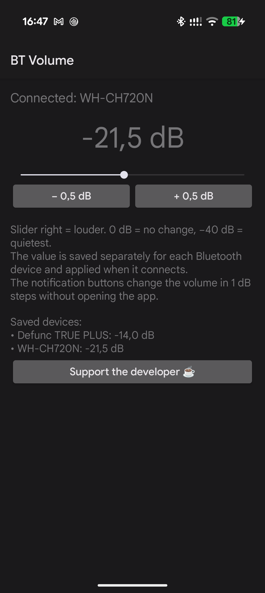
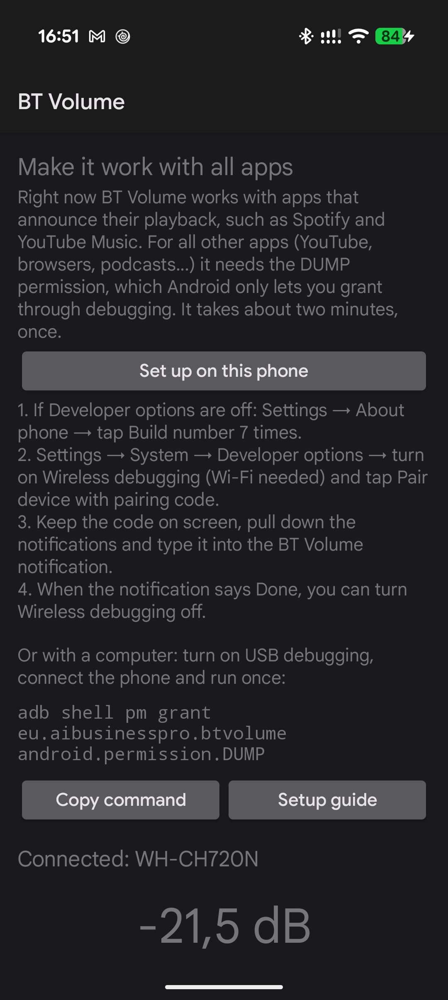

# BT Volume

Per-device volume attenuation for Bluetooth audio on Android. Go quieter than the lowest system volume step and fine-tune the volume in 0.5 dB steps.

On many phones the lowest volume step is still too loud for some headphones, and the steps in between are coarse. BT Volume remembers an extra attenuation for each Bluetooth device and applies it automatically whenever that device connects.

> **Status: beta.** Tested only on a Pixel 10 Pro with Android 17. Reports from other phones are very welcome.

## Screenshots

 

## Features

- Attenuation from 0 dB (no change) down to −40 dB, saved separately for each Bluetooth device
- 0.5 dB steps in the app, 1 dB steps from the notification
- Works on top of the normal volume buttons
- Works right away with players that announce their playback, such as Spotify and YouTube Music
- One-time setup on the phone itself (no computer needed) to make it work with other apps too
- No ads, no tracking
- English and Czech

## Requirements

- Android 12 or newer
- For apps other than Spotify, YouTube Music and similar players: a one-time setup over Wi-Fi (see [Setup](#setup))

Tested on a Pixel 10 Pro with Android 17. It should work on other phones too, but has not been tested there yet. If it does or does not work on your phone, please [open an issue](../../issues) with the phone model and Android version.

## Install

1. On your phone, download the APK from [Releases](../../releases).
2. Open it, allow installing apps from this source and tap **Install**.
3. Open BT Volume and allow notifications.

Google Play Protect may warn that the app is unknown, because it is not from Google Play. Only continue (**More details → Install anyway**) if you downloaded the APK from the Releases page of this repository. To check that the file is genuine:

- its SHA-256 checksum must match the one in the release notes;
- it must be signed with the BT Volume certificate:

  ```
  apksigner verify --print-certs BT-Volume-<version>.apk
  ```

  must show `CN=AIBP` and the SHA-256 digest `652807b56954fe43c1778e221b22ea0557bdc11347184f893487a98a07703a7a`.

## Setup

Without setup, BT Volume works in **basic mode**: it attenuates players that announce their audio session to the system (Spotify, YouTube Music, Samsung Music and some others). Many apps do not do that, for example YouTube, browsers, podcast apps and most pre-installed players.

For those, BT Volume needs the **DUMP** permission, which tells it which apps are playing. Android only lets you grant it through debugging, once. The app shows the setup box until it is done.

### On the phone (recommended)

Needs Wi-Fi.

1. If Developer options are off: **Settings → About phone →** tap **Build number** 7 times.
2. In BT Volume, tap **Set up on this phone**. It opens Developer options and shows a **BT Volume setup** notification.
3. Turn on **Wireless debugging**, open it and tap **Pair device with pairing code**. Keep the code on screen.
4. Pull down the notifications, tap **Enter pairing code** in the BT Volume notification and type the code.
5. When the notification says **Done**, turn Wireless debugging off. You can also remove **BT Volume** from its list of paired devices.

### With a computer

1. Enable Developer options (see above) and turn on **Settings → System → Developer options → USB debugging**.
2. On the computer, install [Android SDK Platform-Tools](https://developer.android.com/tools/releases/platform-tools) (it contains `adb`).
3. Connect the phone with a USB cable and confirm **Allow USB debugging** on the phone.
4. Run:

   ```
   adb shell pm grant eu.aibusinesspro.btvolume android.permission.DUMP
   ```

5. Open BT Volume. The setup box disappears.

Either way, the permission survives reboots and app updates. Uninstalling the app removes it.

## Usage

1. Connect your Bluetooth headphones, speaker or car.
2. Open BT Volume and move the slider. Right = louder, 0 dB = no change.
3. The value is saved for that device and applied every time it connects.
4. Use **− Quieter** and **+ Louder** in the notification to adjust by 1 dB without opening the app.

## How it works

- BT Volume attaches Android's `DynamicsProcessing` audio effect with a negative input gain to the audio session of every app that plays to the Bluetooth output.
- It learns those sessions from players that send `ACTION_OPEN_AUDIO_EFFECT_CONTROL_SESSION` (basic mode) or, with the DUMP permission, by reading `dumpsys media.audio_flinger`, where it takes only the sessions on Bluetooth outputs.
- It uses the settings of the Bluetooth device that media is actually routed to (Android 13 and newer). When media goes to the phone speaker while headphones stay connected, nothing is attenuated.
- It does not use a single global effect on the output mix (audio session 0). On Pixel phones with Android 17, audio that is not spatialized bypasses that global effect. That is also why the "legacy mode" of some equalizer apps has no effect there.
- Android keeps an audio effect running with its last settings even after the app that created it lets go of it. BT Volume therefore always resets an effect to 0 dB before releasing it, including after the app was stopped by the system.
- The setup on the phone uses [libadb-android](https://github.com/MuntashirAkon/libadb-android) to pair with the phone's own Wireless debugging and run exactly one command, `pm grant eu.aibusinesspro.btvolume android.permission.DUMP`. The key for this connection exists only in memory for that one attempt, so the app cannot connect again later.

## Limitations

- Phone calls are not affected.
- It can only make audio quieter, not louder.
- When an app starts playing, the first fraction of a second can be at full level until the effect is attached.
- Some phone makers block granting permissions through debugging (reported on some OnePlus phones). Then only basic mode works.
- In basic mode, BT Volume cannot see which output each single app uses. It follows where media goes in general.
- On Android 12 the media route cannot be read, so the first connected Bluetooth output is used.
- If the effect cannot be applied, or the app that is playing needs the one-time setup, the app and the notification say so.
- The format of the system audio dump can differ between phone makers and Android versions. If attenuation does not work on your phone, please open an issue.

## Privacy

- No ads, no analytics, no data leaves the phone. Settings stay on the phone: Android backup and transfer to a new phone are turned off for BT Volume.
- The **INTERNET** permission is needed only for the setup on the phone: Android requires it for any network connection, including the one to the phone's own Wireless debugging. BT Volume never connects to the internet.
- The **DUMP** permission lets it read system diagnostic output; it uses only the list of audio sessions that play to Bluetooth.

## Support

BT Volume is free. If it helps you, you can support its development:

[](https://ko-fi.com/jpaibp)

The app also has a **Support the developer** button that opens the same page.

## Building

Requirements: JDK 17 or newer and the Android SDK with platform 36.

```
./gradlew assembleDebug
```

Release builds are signed with a key that is not part of this repository.

## License

BT Volume is licensed under the [GNU General Public License v3.0](LICENSE).

It uses libadb-android (GPL-3.0-or-later or Apache-2.0), spake2-android (LGPL-3.0-or-later), Conscrypt with BoringSSL (Apache-2.0), Bouncy Castle (MIT), the Kotlin standard library and two annotation libraries (Apache-2.0). The full list with all license texts is in [THIRD_PARTY_NOTICES.txt](src/main/assets/THIRD_PARTY_NOTICES.txt); the app shows it under **Open-source licenses**.
